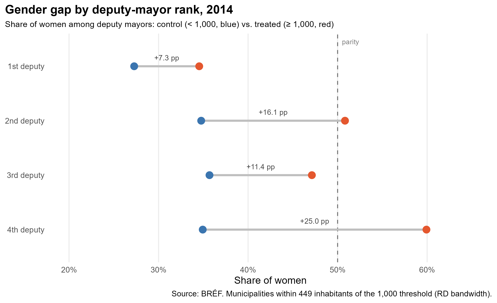

# Descriptive Representation Without Executive Power: The Incomplete Effects of Gender Quotas

Replication code for a policy-analysis paper on the French municipal gender-quota
reform (Sciences Po, M1 policy analysis project, 2026). The full paper is in
[`paper/gender_quotas_paper.pdf`](paper/gender_quotas_paper.pdf).

**Authors:** Zélie Barreteau, Justine Duplessis, Prune Legrand, Marianne Patte, Gabrielle Piorka

## Research question

In 2013, France extended its *zipper* quota (strict gender alternation on candidate
lists, plus parity among deputy mayors) from municipalities above 3,500 inhabitants
to those above **1,000 inhabitants**. The mayor's seat itself remained unconstrained.
We ask:

1. **Where does the glass ceiling lie?** Did the quota raise women's representation
   among councillors, deputy mayors *and* mayors?
2. **Is there a role-model effect?** Is the quota more effective where women already
   held local leadership positions?

## Data and design

* **~35,000 municipalities × 4 elections (2001–2020)** built from two administrative
  registers of elected officials — BRÉF (historical RNE extracts) and the current
  Répertoire National des Élus — about 1.6 million officials aggregated to the
  municipality level, linked to INSEE legal populations, census covariates and
  presidential vote shares.
* **Difference-in-discontinuities** at the 1,000-inhabitant threshold (Grembi et al.
  2016; Lassébie 2020). A simple RD is confounded at 1,000 by the switch from
  majoritarian to list voting and by sorting (density test, Table B1). Differencing
  the 2014/2020 discontinuity with the pre-reform 2008 one removes both:

  $$Y_{it} = \alpha_t + \beta_t\,\mathbb{1}[pop_i \geq 1000] + f_t(pop_i - 1000) + \varepsilon_{it}, \qquad \delta_t = \hat\beta_t - \hat\beta_{2008}$$

  Local linear estimation with `rdrobust` (Calonico, Cattaneo & Titiunik 2014),
  CCT-optimal bandwidths, municipalities that never cross the threshold.

## Main results

| Effect of the quota (2014 vs. 2008) | Estimate | Reading |
|---|---|---|
| Share of female **councillors** | **+7.1 pp\*\*\*** (s.e. 0.025) | +20% relative to the control mean of 35.5% |
| Share of female **deputy mayors** (simple RD) | **+11.1 pp\*\*\*** (s.e. 0.022) | upper bound — not observed before 2014 |
| Probability of a female **mayor** | +1.7 pp (s.e. 0.068) | no effect |

The glass ceiling sits exactly where the legal constraint stops — between deputy
mayors and mayors. Even among deputies, parity is reached only at the ranks the
zipper rule makes binding:



The design passes its validity checks: pre-determined covariates are balanced at the
threshold (Table B2), and re-estimating the model at placebo cutoffs (500, 750, 1,500
and 2,000 inhabitants) yields no significant effect at any level (Table B3, all p > 0.2).

Splitting the sample by prior female leadership (Tables 3–4), the quota effect on
councillors is **largest where women were least represented** — evidence that the
legal mandate substitutes for, rather than amplifies, role-model dynamics.

## Repository structure

```
.
├── run_all.R                    # Reproduces everything, in order
├── R/
│   ├── 00_config.R              # Packages, paths, constants, RD / diff-in-disc helpers
│   ├── 01_build_officials.R     # BRÉF + RNE → 1.6M officials → municipal outcomes
│   ├── 02_build_covariates.R    # INSEE census shares, left-wing vote share
│   ├── 03_build_panel.R         # Sample restrictions, stable municipalities, lags
│   ├── 04_descriptives.R        # Table 1
│   ├── 05_validity_checks.R     # Density test, covariate balance, placebo cutoffs
│   ├── 06_main_results.R        # Table 2 + robustness table
│   ├── 07_deputy_ranks.R        # Figure: gender gap by deputy-mayor rank
│   ├── 08_role_model.R          # Tables 3 and 4
│   └── 09_rd_plots.R            # Appendix figures A1–A3
├── data/
│   ├── raw/README.md            # Sources and download links (data not versioned)
│   └── processed/               # Built by 01–03 (not versioned)
├── output/
│   ├── tables/                  # .html and .png for every table
│   ├── figures/                 # .png for every figure
│   └── main_estimates.csv       # All Table 2 / robustness estimates, machine-readable
└── paper/
    ├── gender_quotas_paper.pdf
    └── latex/                   # LaTeX source of the paper (main.tex + figures)
```

## Data sources

Ministère de l'Intérieur — Répertoire national des élus (2025); Labatut et al. (2025),
BRÉF, Zenodo; INSEE — legal populations and population census; NosDonnées.fr —
2007 and 2012 presidential results. Full references and links in
[`data/raw/README.md`](data/raw/README.md).
